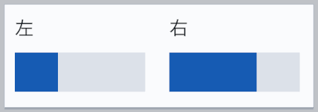
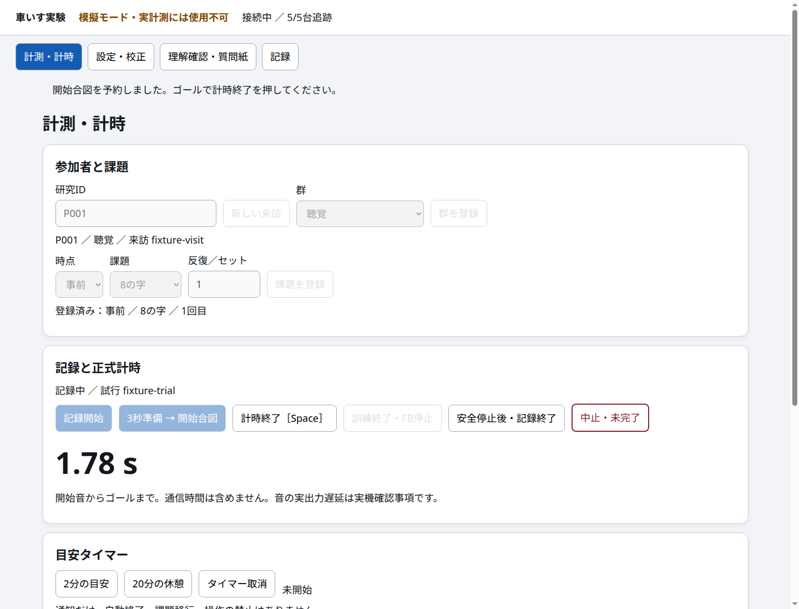
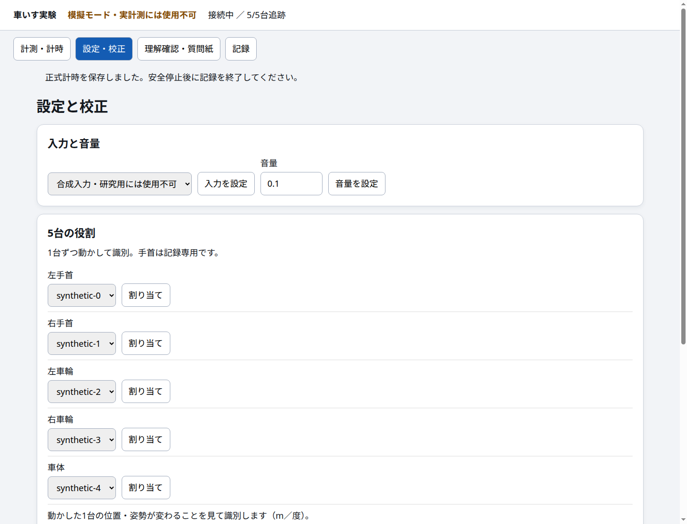
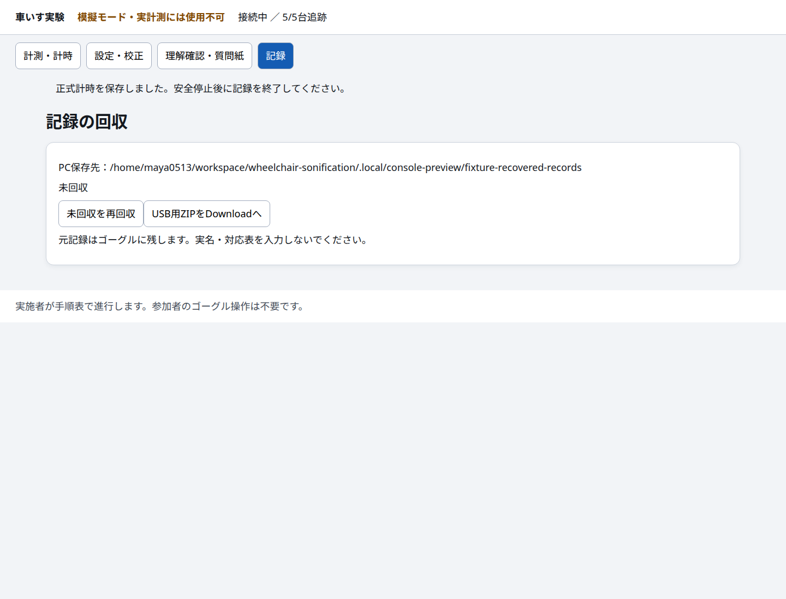

# アプリの概要

車いすをこぐ練習中に、左右の車輪の速さを音やゲージで返す研究用アプリです。VIVE Focus Visionで計測・提示・保存し、実施者がノートPCのブラウザーから操作します。参加者はゴーグル内のメニューやコントローラーを操作しません。

以下は、合成入力を使ったUnity EditorとChromeのテスト画像です。実機のパススルー映像・レンズ越しの画質ではありません。画像内のID・保存先もテスト用です。

## 参加者に返す情報

| 条件 | 練習中の提示 |
|---|---|
| 聴覚 | 左車輪は左、右車輪は右から音。速く回るほど高い音になる |
| 視覚 | 左右2本の棒。速く回るほど長くなる |
| 追加FBなし | 動作情報を追加しない |

直進と8の字の訓練中に提示し、事前・直後・休憩後の評価では全員が追加FBなしで走ります。速さを正解・不正解として判定する仕組みではありません。

視覚条件では、視野の下部に次のゲージだけを出します。

[視野全体での配置を見る](images/app-overview/hmd-view.png)。聴覚条件・追加FBなし条件と評価中は、このゲージを表示しません。詳しい対応関係は[FB仕様](specifications/feedback.md)を参照してください。

## 実施者がPCで行うこと

参加者・群、時点・課題・反復を選び、記録と計時を操作します。タイマーは目安の通知で、実験は自動で進みません。

評価の基本操作は「記録開始 → 開始合図 → ゴールで計時終了 → 安全停止後に記録終了」です。PCから準備音・開始音を出し、ゴールを見てボタンかSpaceキーで時計を止めます。訓練では「訓練終了」で音・ゲージを止めてから、安全停止後に記録を閉じます。[当日の操作手順](development/experiment-console.md)

設定ページでは、5台のトラッカーを左右手首・左右車輪・車体へ割り当て、左右の車輪軸を校正します。手首は記録だけに使い、フィードバックは車輪から作ります。

音・ゲージの見本を出すボタン、口頭の理解確認・質問紙の入力欄もあります。操作は実施者が行います。

## 記録と取り出し

元の位置姿勢・車輪速度はゴーグルへ、正式な課題時間と回答はPCへ保存します。試行が終わると、その試行の記録をPCへ自動コピーしてチェックサムを照合します。失敗した記録は、記録ページから再回収できます。

PCの通常の保存先はホーム内の `WheelchairSonificationData/` です。USBで取り出す場合は、ゴーグルの `Download/WheelchairSonificationExports/` へZIPを書き出します。参加者名ではなく研究IDを使います。[保存内容と回収方法](development/research-records.md)

会場にインターネットやWi-Fi設備がなくても、ノートPCのホットスポットへゴーグルを接続して使う構成です。PCではUnityやVIVE Hubを常時動かす必要はありません。[導入方法](development/android-build.md)

## 現在の確認範囲

PC上で計算・手動操作・記録回収・再解析、画面と音見本、署名付きAPKの内容を確認しています。実機での5台同時追跡、左右の聞き分け、可読性、計測精度、現地での単独実施は確認が必要です。[確認済みの証拠と残作業](development/remaining-work.md)

Releaseの `app-overview.zip` にはこのMarkdownと画像、`ui-preview.zip` には全画面と音見本が入ります。
