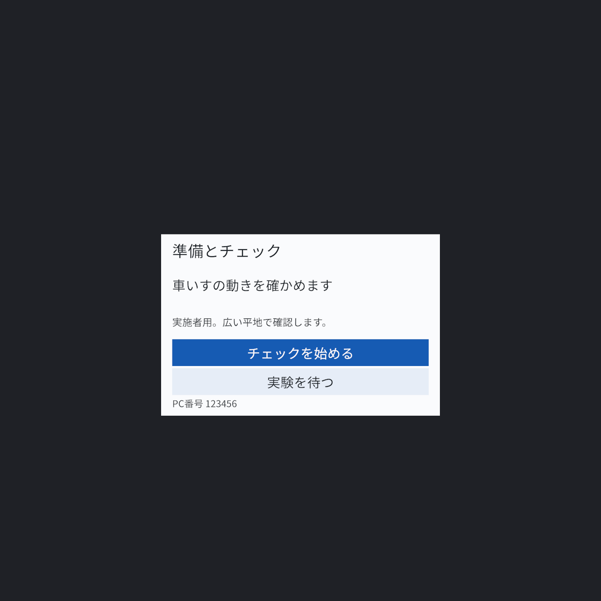

# アプリの概要

車いすをこぐ練習中に、左右車輪の速さを音やゲージで返す研究用アプリです。VIVE Focus Visionで計測・提示・保存し、ノートPCのブラウザーで実験の記録と正式計時を操作します。

実施者の準備にはゴーグル単体の案内付きチェックを使えます。本実験中の参加者は、メニューやコントローラーを操作しません。

以下は共通Unity UIとChromeを合成入力で撮影したテスト画像です。実機のパススルー・レンズ画質・実測結果ではなく、IDや保存先もテスト用です。

## まず、機器を準備する

ゴーグルで「チェックを始める」を選び、止まる・前へ進む・後ろへ戻る案内に従います。ソフトが車体・左右車輪の候補と回転軸を求め、実物と照合して確定します。

候補を絞れない場合は、実物の位置に出る目印を指して選び直します。番号0〜4とHMDの1〜5の対応を覚える必要はありません。機器A〜Eはこのアプリ内の目印です。

停止・前後進・旋回と、表示・音の見本を順番に確認します。走行用3台で機能チェックでき、手首2台は追加記録用として別に表示します。研究計画の5台構成や測定精度の受入れ条件は維持します。

PCには同じ案内、割当、進捗、項目別結果を表示します。数値や機器IDは詳細欄で扱います。音だけ・表示だけなどの再確認と、参加者の装着後の短い確認もできます。

A／Xでメニュー、B／Yでパネルを正面へ再配置します。動作中は大きなパネルやポインターを隠し、コントローラーを持たずに確認できます。[準備とチェックの手順](development/tracker-measurement.md)

## 参加者に返す情報

| 条件 | 訓練中の提示 |
|---|---|
| 聴覚 | 左車輪は左、右車輪は右から音。速いほど高くなる |
| 視覚 | 左右2本の棒。速いほど長くなる |
| 追加FBなし | 動作情報を追加しない |

直進と8の字の訓練中に提示し、すべての評価では追加FBなしで走ります。速さを正解・不正解として判定する仕組みではありません。

[視野全体での配置](images/app-overview/hmd-view.png)。聴覚・追加FBなし条件と評価中はゲージを表示しません。[FB仕様](specifications/feedback.md)

## PCで実験を行う

参加者・群、時点・課題・反復を手動で登録し、画面の案内に沿って記録と計時を操作します。タイマーは通知だけで、実験は自動で進みません。

評価は「記録開始 → 開始合図 → ゴールで計時終了 → 安全停止後に記録終了」。開始音からPCで計時し、ボタンかSpaceで止めます。訓練は「訓練終了」でFBを止め、安全停止まで元データを残します。理解確認と質問紙もPCで保存します。[操作手順](development/experiment-console.md)

## 保存と回収

元の位置姿勢・車輪速度はゴーグル、正式な課題時間・回答はPCに保存します。単体チェックは研究試行とは別に保存し、PC接続後に回収できます。試行終了後は一試行分を自動コピーし、チェックサムを照合します。元データはゴーグルに残ります。

PCの初期保存先は `~/WheelchairSonificationData/`。USB用ZIPはHMDの `Download/WheelchairSonificationExports/` に出します。実名は入力しません。[保存項目](development/research-records.md)

現地の外部回線は不要で、PCのホットスポットに接続して使います。PCでUnity・VIVE Hubを常時実行する必要はありません。**対応するAPKとコンソールを一緒に更新してください。** [導入方法](development/android-build.md)

## 確認できている範囲

PC上の計算・状態遷移・保存・転送、Unity画像とブラウザー画面を確認します。実機での自動候補の正しさ、目印の位置、追跡、音の左右分離、可読性、計測精度、現地での単独実施は別に確認が必要です。[確認証拠と残作業](development/remaining-work.md)

Releaseの `app-overview.zip` でこのMarkdownと画像、`ui-preview.zip` で全画面と音見本を確認できます。
