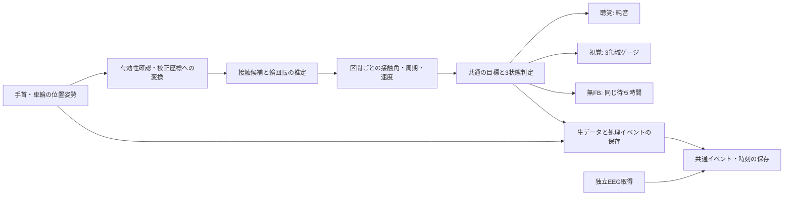

> **旧案（2026-10-14）**：区間終了後FB・EEG追加を含む初期の実装検討を保存した資料。現行の研究要件は[FB仕様](../feedback-specification.md)と[研究計画](../study-plan.md)。以下の検出閾値・構成・自動的な頻度への変更案は、現行仕様として承認されたものではない。

# 手元の機材を使う最小システム案

この文書の数値は**予備実験を始めるための設計値**。文献で保証された精度・臨床的な最適値ではなく、手元の機器で未実測である。実験アプリを今回実装・動作確認したという意味ではない。

## 推奨する最小構成

PC＋手首・車輪トラッカー＋Unity＋有線の音出力＋固定画面。計測処理は逐次行い、**直進区間の完了後、停止位置で即時の要約FB**を提示する。視覚・聴覚で同じ時点・同じ情報を提示でき、型番不明のHMDで周囲が見えることを前提にしなくてよい。[L14](../../research/papers/L14-yan-2021.md) [L17](../../research/papers/L17-symonds-sensewheel-2016.md)

原案の「走行中の並行FB」を維持する版は拡張案とする。HMDの実空間視認性・装着干渉・共通座標・遅延が確認でき、全群で同じ装着条件にできた場合に限る。区間後の方式と走行中の方式を同じ本実験で混在させない。方式を変えたらタイトル・仮説も対応させる。

| 確認 | 判断 |
|---|---|
| 型番・個数・電池・ドングル・ベースステーション | 手首2＋輪2の4点構成を確認。足りなければ片側2点を全員の利き手側に統一し、両側指標を削る |
| Tracker方式 | LighthouseかUltimate等かを確認。別方式の機器を同じ座標で動くと仮定しない [D01](../../research/papers/D01-vive-tracker.md) [D04](../../research/papers/D04-vive-tracking-systems.md) |
| 追跡範囲 | 実走行して有効率を地図化。安定して追跡できる範囲へコースを縮め、20 mを前提にしない |
| HMD | 最小案では装着しない。計測系に接続が必要なら机上で使用可能か確認。HMD内の画面を使う案は別途確認 |
| EEG | 同時取得は別プロセスにして、EEG接続不良が運動ログを止めない構成 |

## データの流れ

## 座標と校正

1. トラッカーのserialと左右・手首／輪の役割を保存する。一時的なdeviceIndexの順序を役割にしない。接続・tracking状態を監視。[D02](../../research/papers/D02-steamvr-pose.md)
2. 静止した車いすで床面、車輪面、輪中心、ハンドリム半径を測る。輪トラッカーは固定具が回転に干渉せず、1回転中の遮蔽が少ない位置へ。
3. 輪中心は `c = p_tracker + R_tracker * offset_center` とし、固定したローカルoffsetを保存。輪トラッカーの位置を中心と同一視しない。
4. 手首もセンサー中心ではなく、グリップ時にハンドリムへ触れる点のoffsetを校正する。手首屈伸で剛体仮定が崩れる誤差は動画参照で確認する。
5. 左右輪中心と床面から車体座標を定義。輪の相対回転は車体の旋回と分け、車輪軸まわりの回転をunwrapする。単純なEuler角の差や、回る車輪座標内の手の角度だけをpush角としない。

原著のpush角は推進区間中の輪回転等で定義される。[L16](../../research/papers/L16-guo-optipush-2011.md) [L31](../../research/papers/L31-soltau-2015.md)。今回は区間の開始・終了が位置由来なので、名称を**推定ハンドリム接触角**とし、力閾値によるpush angleと区別する。

## 接触候補とストローク

手の校正点を車輪面へ投影し、半径との差、面からの距離、輪周上の点と手の相対速度を使って候補区間を検出する。近いだけでは接触・推進力の発生を証明しない。停止・制動・惰性中の接触を別ラベルにする。

初期値は半径誤差30 mm以内・面距離40 mm以内、50 ms持続で接触候補。終了側はより広い閾値（半径45 mm・面距離60 mm）と50 msでヒステリシスを設ける。これらは機器精度・手のoffsetによって調整する仮値であり、動画との照合前に本計測へ使わない。1候補100–1500 msを暫定範囲とし、外れは値の切り詰めで正常化せず不明扱い。

接触候補開始・終了に対応する輪の累積回転差を角度にする。頻度は同じ側の開始間隔の逆数で、左右の回数を混ぜない。直進以外、制動、追跡欠損を含む候補は主角度の算出対象から外す。オンラインは因果的平滑化、事後再解析は別フィールドに保存する。[L25](../../research/papers/L25-ojeda-2014.md) [L28](../../research/papers/L28-fathian-pattern-2025.md)

## 共通の目標と情報提示

主要側は利き手側。反対側は記録可能なら副次指標とする。これにより4点が使えない場合も、片側2点で主要評価の定義を揃えられる。

基準の推定角中央値を `θ0` とし、初期目標は `θ* = min(θ0 + 10°, 100°)`。`θ0 >= 95°`なら増大を課さず`θ* = θ0`。これは最大化を避けた**研究上の仮目標**で、臨床推奨・傷害予防・最小重要差ではない。高い基準値の参加者も事後に除外せず、天井効果を報告する。

直進区間の有効角の中央値から、`θ*−5°未満／±5°以内／θ*＋5°超`の3状態を作る。中央値を出すには主要側で最低3ストロークを必要とし、短いコースでは複数の直進を1区間としてまとめる。情報を貯める距離・本数は予備実験で固定する。

| 状態 | 聴覚 | 視覚 |
|---|---|---|
| 角度が小さい | 440 Hz純音 | ゲージ左領域のマーカー |
| 目標範囲 | 660 Hz純音 | 中央領域のマーカー |
| 角度が大きい | 880 Hz純音 | 右領域のマーカー |

各1秒、音はクリックを避ける短いフェードを付け、プリロード・2D再生。有線出力を優先し、音量は聞き取り可能な快適範囲に調整・記録。視覚だけに実測数値・履歴・別指標を追加しない。無FBも停止後に同じ1秒を待つ。3状態の説明と模擬10問の確認を行い、9/10未満なら説明を1回繰り返して結果を残す。[L08](../../research/papers/L08-dubus-2013.md) [L33](../../research/papers/L33-kimura-2016.md)

この3状態音は連続ソニフィケーションの直接追試ではない。Fujiiの10 ms更新や、聴覚にガイダンス仮説が当てはまらないという主張と結びつけない。

## ログの最小仕様

| ファイル | 必須項目 |
|---|---|
| session metadata | 匿名ID、群、機器型番・serial、ソフト版、校正値、椅子設定、利き手、目標、コース、割付順序 |
| pose | sample_id、取得・受信時刻、役割、position[m]、quaternion、tracking_valid。速度はm/s、角度はradかdegを列名で明記 |
| stroke | side、start/end、推定角[deg]、周期[s]、区間ID、有効／除外理由、オンライン値と再解析値の区別 |
| event | phase/trial開始終了、FB判定、送信時刻、音呼出しdspTime、表示フレーム、休憩、校正やり直し |
| EEG | 生波形・機器時刻・受信時刻・欠落・品質。運動ログとは別保存 |

間隔はmonotonic clockで計算し、セッション開始のUTCも保存する。LSLを使う場合はXDFの時刻補正情報も残す。[L45](../../research/papers/L45-kothe-2025.md) [D05](../../research/papers/D05-lsl-time.md)。CSV等にする場合もタイムスタンプを壁時計だけに依存しない。

## 検証と失敗時の扱い

| 検証 | 予備実験での開始基準（独自設計値） |
|---|---|
| 接触イベント | 動画参照とのF1 >= .90、イベント時刻MAE <= 50 ms |
| 接触角 | MAE <= 3°、平均偏り <= 2°、Bland–Altmanも提示。範囲別の誤りを確認 |
| データ取得 | 規定区間の有効率 >= 95%、時刻逆転なし、連続欠損を記録 |
| 提示遅延 | 共通判定確定→実際の提示開始P95 <= 200 msを目標。1秒の予約待ちを遅延から隠さない |
| 再装着 | 取り外し後に再校正して上記を再確認 |

動画は車輪面に近い向きから固定撮影し、既知半径と輪上マーカーを用いる。可能なら60 fps以上。接触ラベルは別の評価者の部分再確認も行い、不一致と投影誤差を残す。動画で確認できる接触は、力が伝達されたpush相の正解ではない。

200 msは今回の区間後FBの運用目標。[L51](../../research/papers/L51-nown-2023.md)の100 ms以下というレビュー採択定義とも、[L50](../../research/papers/L50-niehorster-2017.md)のHMD表示22 msとも別である。実際の音開始は音録音と画面／物理イベントの同時記録で確認し、ソフトの呼出しログだけで測定済みにしない。[D03](../../research/papers/D03-unity-audio.md)

tracking loss中はFBを止め、最後の値を新しい成績として出さない。区間を不明扱いにし、再捕捉後は中心・基準のずれを確認。欠損をまたぐストロークは補間して主指標に使わない。[L50](../../research/papers/L50-niehorster-2017.md)

**角度の検証が通らなければ、本計測開始前に**主要指標・FBをプッシュ頻度へ一括変更する。個人基準の10%低下を目標とし、速度を同条件で記録する。回数・頻度を動画で検証してから採用し、角度群と頻度群を混在させない。極端な頻度減少・負荷軽減の主張を避ける。[L15](../../research/papers/L15-richter-2011.md) [L25](../../research/papers/L25-ojeda-2014.md)。頻度も検証できなければ装置実現性研究として扱い、無検証の学習効果比較を行わない。
