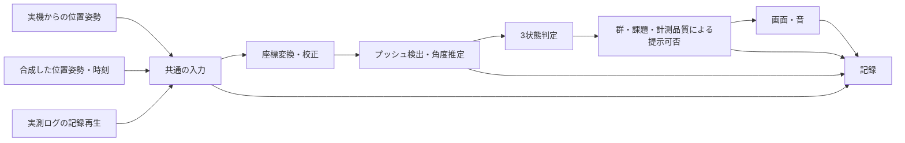

# Unity・計測機器の開発とテスト方法：本研究のための入門

Unityやハードウェア開発の経験が少ない人が、車いす推進の計測・フィードバック（FB）装置を段階的に作るための資料。公式資料で確認した機能と、本研究への推奨を分けて記す。実装や性能確認を進める際の手引きとして使う。

提示規則は[フィードバック仕様](../specifications/feedback.md)、性能の受入れ基準は[検証計画](../specifications/validation.md)、本計測を始める判断は[実施運営](../operations/study-operations.md#本計測開始条件)で確認する。先行装置の構成は[装置比較](../../research/topics/device-comparison.md)を参照する。

## 最初に押さえる考え方

**機器がなくても、模擬入力で判定・画面・音・記録の開発は進められる。ただし、早い段階で実機を接続し、追跡範囲と実空間の視認性を確認する。** ソフトを作り終えてから接続できないことが分かると、研究日程への影響が大きい。

品質の確認には次の二つがある。自動テストに合格しても、後者まで証明されたことにはならない。

| 確認するもの | 本研究の例 | 確認方法 |
|---|---|---|
| プログラムが仕様どおりに動くか | 角度65°をTARGETにする、評価中はFBを出さない | 既知の入力による自動テスト、画面・音の動作確認 |
| 測定・提示が実際の動作を適切に扱えるか | 離手を正しく検出する、推定角度の誤差が小さい、音が回復期に開始する | 動画等との比較、実出力の遅延測定、現地での予備実験 |

現状のリポジトリで確認した環境は以下のとおり。研究用の検出・提示処理やテストはまだない。

| 項目 | 確認結果 |
|---|---|
| Unity Editor | `6000.6.4f1`（Unity 6.6）。`ProjectVersion.txt` に記載 |
| Input System | `1.19.0`。キーボード等や対応デバイスの入力を扱うパッケージ |
| Test Framework | `1.8.0`。テストを実行するパッケージ。導入済みでも研究用テストは別途必要 |
| XR関連SDK | XR Interaction ToolkitやOpenXRは現行 `manifest.json` に未登録。必要なSDKは機器確認後に選ぶ |
| 手元の機器 | VRゴーグル・トラッカーの型番、個数、接続先、追跡方式は未確認 |

最初に学ぶUnityの言葉は、**Scene**（場面の構成）、**GameObject**（画面やカメラ等を置く単位）、**Component**（それに付ける機能）、**Inspector**（設定を編集する画面）、**Prefab**（再利用する構成）、**MonoBehaviour**（Unityの実行周期に参加するC#の処理）で十分。まず小さい場面を一つ作り、ボタンで表示と音を切り替え、実行を止めて設定を変える流れに慣れる。

## モック・シミュレーター・記録再生はどう違うか

「モック」は画面の試作品にも、テスト用の代役にも使われる言葉。本資料では用途を次のように分ける。テスト用の代役全般は**テストダブル**と呼ばれ、stub／fake／mockの細かな定義には流派差がある。[.NETの用語とテスト設計][M1]

| 方法 | 本研究での使い方 | 確認できること | これだけでは確認できないこと |
|---|---|---|---|
| 画面モック | 3領域ゲージを仮表示し、ボタンでマーカーを動かす | 配置、表示内容、操作の分かりやすさ | 実走行中の視認性、推定精度 |
| 固定値の模擬入力（stub） | 「今の角度は64.9°」と既知の値を渡す | 境界値の判定、音・マーカーの対応 | 接触角の算出が正しいか |
| 呼出しを確認するmock／spy | 音を鳴らす代役に「何回・どの状態・いつ依頼されたか」を記録させる | 無FB時の呼出しゼロ、重複、取消 | スピーカーから出た音、画面の実表示 |
| 合成データを返すfake | 手と車輪の位置姿勢・時刻を数式や用意した列で作る | 既知角度、回転の折返し、欠測への対処 | 人の動作や機器の誤差を完全に再現すること |
| 実測ログの記録再生（replay） | 一度記録した入力を同じ時刻列で繰り返し処理する | 不具合の再現、検出法の比較、修正前後の差 | 新しい装着条件の性能、現在の出力遅延 |
| 実機を含む試験 | トラッカー、PC、表示・音響機器を実際につなぐ | 接続、追跡喪失、実出力、機器の負担 | あらゆる参加者・環境での妥当性 |

**シミュレーター**は必要な動作をモデルで再現するもの。**エミュレーター**は対象の命令や実行環境を再現してプログラムを動かすもの、という区別が目安になる。製品の呼び方には差があり、名前より「何を再現しているか」を確認する。

Unityの **Device Simulator** は主にモバイル端末の画面・向き・タッチ等の確認用で、処理性能や対応しないネイティブプラグインまで再現しない。[公式の用途・制約][U4] **XR Interaction Simulator** はキーボード等でHMD・コントローラー・手の入力を模擬する、XR Interaction Toolkitのサンプル機能。旧 **XR Device Simulator** とは名称を区別する。[公式説明][U5]

**本研究への推奨：最初は小さい模擬入力と記録再生を優先する。** XRの視点・入力接続を確認する必要が生じたら、対応SDKと組み合わせてXR用シミュレーターを検討する。これらを入れただけでVIVE Trackerの全機能、手とハンドリムの接触、遮蔽、現地の遅延まで再現できるとは考えない。導入する機能は、実機と対応SDKを確認してから選ぶ。

## テストしやすい作り方

一つの処理に「機器から読む・角度を計算する・鳴らす・保存する」を全部入れると、機器がない日に計算を調べることまで難しくなる。**入力、計算、提示、記録を分け、つなぎ目のデータを確認できる形にする**のが本研究への推奨。

共通入力には、少なくとも機器ID、位置、姿勢、時刻、追跡の有効・無効を含める。**姿勢**は物体の向きのこと。機器取得部分だけを差し替え、後段の計算と判定は共通化する。角度を直接与える初期テストは図の「3状態判定」から先を検証するもので、検出処理を検証したとは扱わない。

計算部分は、できるだけ「値を受け取り、結果を返す」普通のC#として作る。**依存性の注入**という技法は、ここでは「入力元や時計を外から渡して差し替えられるようにする」程度でよい。大きな専用フレームワークは必須ではない。Unityの表示・音・ボタン処理をMonoBehaviour側に置けば、計算だけを素早く試しやすい。[外部依存を避ける単体テスト][M1]

時間に依存する処理には、テスト時に進められる**模擬時計**を渡す。例えば「100 ms進める→次のプッシュ→300 ms進める」と指定すれば、実際に毎回待たずに取消・打切りを確認できる。一方、実機出力の測定では実際の時計と装置を使う。

Unityの`Update`や`FixedUpdate`はエンジンの更新処理で、機器の測定周期そのものではない。画面が毎秒90回更新されても、毎秒90個の独立したセンサー測定が得られたとは限らない。[実行順序][U13] SDK（機器用の開発ライブラリ）の更新方式・時刻・予測や補間の有無を確認し、受信間隔も実測する。平滑化する場合は、未来のデータを使わないオンライン処理にする。

## テスト手法の使い分け

**単体テスト**は小さな計算等を既知の入力と期待結果で確認すること。**結合テスト**は部品をつないだ動作の確認。**回帰テスト**は修正によって以前できていたことが壊れていないかの再確認。これらは目的の違いであり、Edit Mode／Play Modeという実行場所とは別の分類になる。

| 試験 | 本研究の対象 | 道具・方法 | 残すもの |
|---|---|---|---|
| 単体 | 目標算定、角度差、3状態判定、提示可否 | Edit Mode、固定入力、模擬時計 | 入力・期待値・結果 |
| 結合 | 入力から判定、提示、ログまで | Play Mode、テスト用の場面、記録再生 | 状態・提示依頼・ログの対応 |
| 回帰 | 一度直した不具合、代表的な動作 | 固定したデータと期待結果を再実行 | 修正前後の差、テスト結果 |
| 異常系 | 欠測、接続断、不正値、保存失敗 | 模擬入力や保存処理の代役に意図的に異常を起こす | 検出・無提示・通知・停止理由 |
| 実機 | 接続、校正、機器ID、角度、画面・音 | 公式サンプル、動画、実出力の記録 | 機器構成、誤差、遅延、有効率 |
| 長時間 | ログ蓄積、メモリ、電池、再接続 | 実運用と同じ構成で90分以上の技術試験 | 中断、ファイル整合、性能推移 |
| 現地通し | 設営、視認、教示、操作、90分の進行 | 既存計画の2–3名の予備実験 | 所要時間、逸脱、負担、修正点 |

長時間の技術試験は、人を90分以上走らせる意味ではない。模擬・記録再生による稼働と、必要な範囲の実機動作確認を組み合わせる。追跡・電池等は実機を実際に動かす確認も必要。

### Unityで最初のテストを動かす流れ

Unity Test FrameworkはNUnitというC#のテストライブラリを基にし、通常の`[Test]`と、フレームを待つ等のUnity固有処理に対応する`[UnityTest]`を提供する。[公式概要][U0] **Edit Mode**はEditor内で計算等を確認し、**Play Mode**は実行中の画面・音・状態遷移を確認する入口にする。Play Modeテストは対応するPlayerでも実行できる。[実行場所の違い][U1]

1. テスト対象の計算を独立したまとまりにする。**Assembly Definition（`.asmdef`）**は、C#コードをどのまとまりとしてコンパイルするかを指定するファイル。対象コードとテストの参照関係を設定する。
2. Test RunnerでEdit Mode用のテストを作り、「目標70°、角度65°ならTARGET」の1件を実行する。
3. 境界値と無効入力を足し、入力を用意する→処理を実行する→期待結果と比較する、の順に書く。
4. Play Modeで提示と取消を確認し、最後にビルドしたアプリを実際の使用機器で動かす。

テスト用アセンブリから既定の`Assembly-CSharp`を直接参照できない点に注意する。[公式の構成条件][U1] Test Runnerには個別実行・Run All等がある。[操作方法][U2] Input Systemの接続部分を調べる段階では、ハードウェアなしで入力を作る`InputTestFixture`も使えるが、専用のテスト参照・`testables`設定等が必要になる。最初の角度判定には不要。[Input System 1.19の入力テスト][U3]

## 確認するテストケース

目標算定、境界値、提示の取消、欠測、保存異常、再起動の確認例は[テストケース一覧](test-cases.md)にまとめる。手計算や独立した参照データから期待値を用意し、判定の実装と実機の測定精度をそれぞれ確認する。

## 開発はどの順序で進めるか

以下は本研究への推奨順序。各段階で小さく動くものを残す。**機器の型番・接続・追跡範囲・実空間の視認性の確認は、段階1–3と並行して早期に行う。**

| 段階 | 作る・調べるもの | 残す成果 | 次へ進む確認 |
|---|---|---|---|
| 1 | ボタンで3状態を出す小さい場面 | 画面モック、3音、操作手順 | 対応、300 ms、消去を座位で確認 |
| 2 | 既知角度から判定して提示 | T01・T02、無FBのテスト | 境界・目標・群による出力が一致 |
| 3 | 合成した手・輪の位置姿勢と時刻 | 正常・折返し・欠測の固定データ | 校正・検出・無効扱いを切り分けられる |
| 4 | 実機から位置姿勢を読む・記録する | 最小の接続例、機器一覧、生の取得ログ | 軸・単位・ID・時刻・追跡状態が分かる |
| 5 | 記録再生で検出を改善する | 参照ラベル、回帰データ、変更比較 | 同じデータで再現し、独立した記録でも確認 |
| 6 | 車いすへの固定、動画参照、実出力測定 | 角度・検出誤差、追跡率、遅延分布 | 既存の初期受入れ目標と照合できる |
| 7 | 実運用ビルドで通し予備実験 | 90分の記録、修正点、使用するビルドとGitコミット | 運営資料の本計測開始条件G1–G6を確認 |

段階1の画面・音確認は機器を着けて走る前にできる。段階4では公式サンプルでトラッカーに対応するCube（立方体）を動かす程度から始め、研究アプリ全体へ一度に組み込まない。VIVE TrackerのSteamVR接続例では、役割に対応する入力を設定して位置姿勢を受け取る手順が示されている。ただし、これは手元の型番・Unity版での動作保証ではない。[HTC公式例][H1]

## 品質保証と、日々の開発を楽にする工夫

**品質保証（QA）**は、最後にバグを探す作業だけでなく、同じ条件で作れ、試せ、記録を追えるようにする仕組み。本研究では次を優先する。

| 工夫 | 具体的な実践 | 目的 |
|---|---|---|
| 小さい変更・Gitコミット | 一度に1機能を変え、動作確認と理由を残す | 壊した変更を絞り、動く版へ戻せる |
| 設定の一元化 | 目標規則、許容幅、音、提示長等を一か所に置く | 音・表示・解析で別の設定が使われるのを防ぐ |
| 仕様とテストの対応表 | FB仕様の項目→T01等→結果・日付を対応付ける | 何を検証していないか分かる |
| 不具合の再現記録 | 入力ファイル、操作順、期待／実際、画面、版を残す | 「たまにおかしい」を繰り返し調べられる |
| 状態を明示 | 準備・校正・訓練直進・8の字・評価・停止を区別 | 出してはいけない場面でFBが出るのを防ぐ |
| 自動テストと固定データ | 重要な計算・境界・過去の不具合を再実行 | 同じ確認を手で繰り返す負担を減らす |
| デバッガー | ブレークポイントで止め、変数を一段ずつ調べる | 計算や状態遷移の原因を特定する |
| Profiler | 実運用機器のDevelopment Buildで処理時間・メモリを観察 | 入力処理・表示・保存等の負荷を調べる |
| バージョンの固定 | Unity、パッケージ、SDK、OS、設定、Gitコミットを記録 | 環境変更による差を追う |
| 予備実験後の条件確定 | 検証済みビルドと設定を保存し、変更後は該当項目を再確認 | 本計測中の条件変更を防ぐ |

設定を共有するUnityの仕組みには**ScriptableObject**がある。Inspectorから参照できるデータ資産として使える。[公式説明][U12] ただし、実行時に使用した設定の控えは各セッションのログにも保存する。Editor上の値を見れば過去の実験条件が分かる、という運用にはしない。

デバッガーはEditorやPlayerへ接続できるが、ブレークポイントでは処理が止まる。[公式の設定][U6] 調査は模擬入力や安全な静止状態で行い、走行中の遅延測定や本計測には使わない。Profilerは実機でのDevelopment Buildに接続して確認する。[実機の性能測定][U7] **Deep Profiling**は詳細な呼出しを調べる分だけ負荷が大きく、動作を遅くする。[公式の制約][U8] 原因調査後は、本番と同じビルド・構成でも提示と記録を再確認する。

**CI（継続的インテグレーション）**は、変更を登録した際等にテスト・ビルドを自動実行する仕組み。まず手元のTest Runnerで再現可能にし、必要ならコマンドライン実行から自動化する。[Unityの実行方法][U2] クラウドでのUnity実行環境・ライセンス設定は別の準備が要る。CIや**カバレッジ**（テストで通ったコードの割合）は、実機精度・視認性・安全性の代わりにはならない。高いカバレッジだけで品質を判断しない。[.NET公式解説][M1]

Unityの`.meta`ファイルは資産の識別子や取込設定を保持するため、資産と一緒にGitへ保存する。移動・名前変更はUnityのProject画面から行うか、外で行うなら対応する`.meta`も一緒に扱う。[公式説明][U11] `Library`等の再生成物と、参加者の映像・生ログを混同してコミットしない。保存先・バックアップは[データ管理方針](../operations/study-operations.md#データ管理)に従う。

## ログと遅延を調べる

保存するデータの構成、時計の使い分け、音と表示の実出力を測る方法は[ログと時刻の測定](logging-and-timing.md)にまとめる。本計測へ進む判断には[検証計画](../specifications/validation.md)の基準を使う。

## ハードウェア側は何から始めるか

既存のVR機器を使うなら、最初から基板を設計する必要はない。**型番を確認→メーカーの最小サンプル→位置姿勢と追跡状態を記録→車いすに固定→校正・実動作検証**の順に進める。SteamVR用VIVE Trackerと他のVIVE系トラッカーを同じ接続方法だと決めつけない。[メーカーの接続例][H1]

| 確認項目 | 小さく試す方法 |
|---|---|
| 軸・単位・向き | 静止基準から既知の方向へ移動・回転し、符号と値を確認。固定具と輪の軸のずれも記録 |
| 機器ID | 1台ずつ動かし、再接続後も手・輪・車体の対応が変わらないか確認 |
| 固定・再装着 | ずれ、緩み、タイヤ・手・衣服との干渉を点検。着け直して校正を再確認 |
| 追跡範囲・遮蔽 | コース全域、直進の往復、8の字の全方向で追跡状態を記録 |
| 接続・電池 | 使用時間、電池残量、無線断、有線の抜け・引掛かりを確認 |
| 画面・音 | 実空間、安全指示、3状態の識別、装着不快を実機で確認 |

もし接触補助センサー等をマイコンで自作する方針を後から選ぶなら、**Wokwi**でArduino Uno／ESP32等のプログラムや対応部品の動作を試せる。[公式概要][H2] [対応機器一覧][H3] 例えばボタンや可変抵抗を仮入力にして、入力取得→閾値判定→通信する値、までを小さく確認する。これは実センサーの圧力応答、装着影響、電気的ノイズ、電池、実際の通信遅延の検証を代替しない。

自作時も、メーカーのデータシートを読み、センサー単体→マイコンで取得→PCへの通信→Unity接続の順に切り分ける。電源電圧、信号レベル、配線、基準電位を確認し、センサー値・接触・推進力を同一視しない。今回の計画では自作基板・追加センサー・脳波を必須にしない。

## 最初の作業と、開発時の確認票

最初に着手するのは、①実機の型番・個数・接続先と視認性の確認、②3状態をボタンで出す場面、③目標70°の境界値テスト、の三つ。Unityの全機能を学んでから始める必要はない。

- [ ] 今回変える仕様と、確認するテストIDが分かる。
- [ ] 同じ入力・設定・時刻列で不具合を再現できる。
- [ ] 正常動作に加え、欠測・無FB・停止・保存失敗を確認した。
- [ ] Editorだけでなく、実運用するビルドと機器でも確認した。
- [ ] ソフトの提示依頼と実出力、計算の正しさと測定誤差を区別した。
- [ ] 動く版・設定・検証範囲・残る問題を記録した。

本計測へ進む判断は、この確認票だけで行わず、[実施運営のG1–G6](../operations/study-operations.md#本計測開始条件)に従う。

## 出典・調査範囲

下表は本資料の技術的な機能・制約を確認した一次資料。**全て2026-10-14確認**。Web本文の関連節を読み、コード例を本プロジェクトで実行したとは扱わない。Unity 6.2以降のTest Framework利用ガイドはUnity Manualへ移動しているため、旧パッケージ版ガイドと混同せずUnity 6.6の資料を参照した。[パッケージ1.8の案内](https://docs.unity3d.com/Packages/com.unity.test-framework@1.8/manual/index.html)

| ID | 公式資料・対象版 | 確認した範囲 |
|---|---|---|
| U0 | [Unity：Testing your code][U0]／Unity 6.6 | NUnit、通常のテストとUnity固有のテスト |
| U1 | [Unity：Edit mode and Play mode tests][U1]／Unity 6.6 | 実行場所、アセンブリ参照、属性 |
| U2 | [Unity：Running tests][U2]・[Test Runner操作][U2a]／Unity 6.6 | Editor・Player・コマンドライン、個別・全件実行 |
| U3 | [Input System：Input testing][U3]／1.19 | 模擬入力、InputTestFixture、テスト設定 |
| U4 | [Unity：Device Simulator introduction][U4]／Unity 6.6 | モバイル向けの用途、再現しない機能 |
| U5 | [XR Interaction Simulator][U5]・[旧XR Device Simulator][U5a]／XR Interaction Toolkit 3.4 | 模擬する入力、サンプル・XR Origin、名称の違い |
| U6 | [Unity：Set up C# debugging][U6]／Unity 6.6 | Editor・Playerへの接続、停止・変数確認 |
| U7 | [Unity：Collect performance data on a target platform][U7]／Unity 6.6 | Development Build、実機へのProfiler接続 |
| U8 | [Unity：Deep profiling][U8]／Unity 6.6 | 詳細計測の負荷・制約 |
| U9 | [Unity：AudioSettings.dspTime][U9]／Unity 6.6 | 音声時計の意味 |
| U10 | [Unity：AudioSource.PlayScheduled][U10]／Unity 6.6 | 音声時刻による再生予約、準備時間 |
| U11 | [Unity：Asset metadata][U11]／Unity 6.6 | `.meta`の役割、移動・名前変更 |
| U12 | [Unity：ScriptableObject data assets][U12]／Unity 6.6 | 共有データ資産とInspector参照 |
| U13 | [Unity：Event function execution order][U13]／Unity 6.6 | 更新処理と物理・描画等の関係 |
| M1 | [Microsoft：Unit testing best practices for .NET][M1]／Web現行、特定の.NET版には固定しない | 再現性、外部依存、テストダブル、カバレッジの限界 |
| H1 | [HTC：Getting Data from VIVE Tracker (SteamVR)][H1]／VIVE OpenXR Web資料、記事の固定版番号なし | 役割と入力の設定、位置姿勢の最小接続例 |
| H2 | [Wokwi：Welcome][H2]／Web現行 | 電子機器・マイコンのシミュレーション用途 |
| H3 | [Wokwi：Supported Hardware][H3]／Web現行 | 対応ボード・入力部品等 |

開発順序、ログ構成、T01–T16、実出力測定の組合せは、これらの公式機能と現行研究仕様を基にした**本研究への提案**。SDK・シミュレーターの導入可否や測定精度は実機確認待ちであり、メーカー資料だけから保証しない。

[U0]: https://docs.unity3d.com/6000.6/Documentation/Manual/test-framework/test-framework-introduction.html
[U1]: https://docs.unity3d.com/6000.6/Documentation/Manual/test-framework/edit-mode-vs-play-mode-tests.html
[U2]: https://docs.unity3d.com/6000.6/Documentation/Manual/test-framework/running-tests.html
[U2a]: https://docs.unity3d.com/6000.6/Documentation/Manual/test-framework/workflow-run-test.html
[U3]: https://docs.unity3d.com/Packages/com.unity.inputsystem@1.19/manual/Testing.html
[U4]: https://docs.unity3d.com/6000.6/Documentation/Manual/device-simulator-introduction.html
[U5]: https://docs.unity3d.com/Packages/com.unity.xr.interaction.toolkit@3.4/manual/xr-interaction-simulator-overview.html
[U5a]: https://docs.unity3d.com/Packages/com.unity.xr.interaction.toolkit@3.4/manual/xr-device-simulator-overview.html
[U6]: https://docs.unity3d.com/6000.6/Documentation/Manual/managed-code-debugging.html
[U7]: https://docs.unity3d.com/6000.6/Documentation/Manual/profiling-target-device.html
[U8]: https://docs.unity3d.com/6000.6/Documentation/Manual/profiler-deep-profiling.html
[U9]: https://docs.unity3d.com/6000.6/Documentation/ScriptReference/AudioSettings-dspTime.html
[U10]: https://docs.unity3d.com/6000.6/Documentation/ScriptReference/AudioSource.PlayScheduled.html
[U11]: https://docs.unity3d.com/6000.6/Documentation/Manual/AssetMetadata.html
[U12]: https://docs.unity3d.com/6000.6/Documentation/Manual/class-ScriptableObject.html
[U13]: https://docs.unity3d.com/6000.6/Documentation/Manual/execution-order.html
[M1]: https://learn.microsoft.com/en-us/dotnet/core/testing/unit-testing-best-practices
[H1]: https://developer.vive.com/resources/openxr/unity/tutorials/tracker-overview/getting-data-from-vive-tracker/
[H2]: https://docs.wokwi.com/
[H3]: https://docs.wokwi.com/getting-started/supported-hardware
