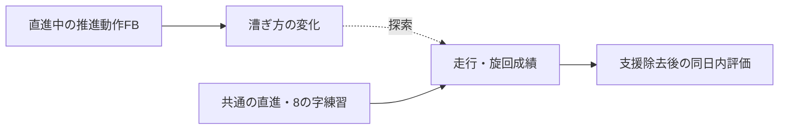

# 中間発表資料・更新版

2026-10-15／研究仕様 v1.1。以下の01–12を1枚ずつのスライド相当として使う。本文は発表用、折りたたみの発表メモは説明・質疑用。結果はまだ取得していない。[詳細資料](README.md)・[元資料との差分](project-baseline.md)。

---

## 01｜研究題目と問い

**走行中の推進動作フィードバックが車いす初心者の平地操作技能の獲得と同日内保持に及ぼす影響**

聴覚・視覚・追加FBなしの小規模3群比較

- 音で漕ぎ方を伝えることは、支援を外した走行・旋回成績にどう関係するか。
- 漕ぎ方の変化と、操作の速さ・正確さを合わせて評価する。

発表者：上山颯太／指導教員：塗木淳夫（原資料の表記）

<details><summary>発表メモ</summary>

元資料のリアルタイム音響FBという方向を維持する。ただし「車いす技能全体」を無制限に扱うのではなく、今回の場所と時間で測れる平地の直進・旋回・加減速へ具体化する。現時点は研究計画で、開発完了・効果実証の報告ではない。

</details>

---

## 02｜背景：漕ぎ方と操作技能

- 車いすの移動には、推進動作に加えて旋回・加減速が必要。
- 接触角・頻度は推進動作の指標になるが、単純な最大化・最小化は避ける。
- 今回は力・代謝・傷害を測らず、操作成績と運動学の変化を扱う。

出典：[Richter 2011](../research/papers/L15-richter-2011.md)、[Symonds 2016](../research/papers/L17-symonds-sensewheel-2016.md)、[亀ヶ谷ら2021](../research/papers/L53-kamegaya-2021.md)。

<details><summary>発表メモ</summary>

原資料の「長い角度・低頻度・左右の力の対称性が傷害予防の鍵」という説明を修正した。角度増大と速度・力の増加が同時に起こる例があり、位置から力を求めることもできない。旋回では意図的な左右差が必要になる。時間短縮を代謝効率の改善とは呼ばない。

</details>

---

## 03｜先行研究と今回の位置づけ

| 研究 | 参考になる点 | 今回との違い |
|---|---|---|
| Gref 2016 | 車いす動作の音への変換 | 質的評価が中心 |
| Symonds 2016 | 走行中、直前のプッシュへ修正方向を教示 | 人による言語FB、保持未評価 |
| Yan 2021 | 視覚FBでも保持・転移が生じる | 区間終了後の要約FB |
| 亀ヶ谷ら2021 | 5 m・1周8の字の計時 | 検者間信頼性。学習への反応性は未検証 |

出典：[Gref](../research/papers/L13-gref-2016.md)、[Symonds](../research/papers/L17-symonds-sensewheel-2016.md)、[Yan](../research/papers/L14-yan-2021.md)、[亀ヶ谷ら](../research/papers/L53-kamegaya-2021.md)。

<details><summary>発表メモ</summary>

車いすを初めて音にする研究ではない。今回の貢献は、検証可能な推進指標、同じ情報を返す聴覚・視覚条件、平地の操作成績、無FBの同日内評価の組合せに置く。Fujii 2016は聴覚の提示頻度を比較した研究で、視覚に対する聴覚の一般的優位性を示すものではない。[Fujii](../research/papers/L05-fujii-2016.md)

</details>

---

## 04｜研究目的・仮説

- 主要な問い：休憩後の無FBでの8の字時間に、群による違いがあるか。
- 副次の問い：接触角が目標へ近づき、時間・正確さの変化と関連するか。
- 聴覚の有用性を期待するが、視覚より優れると決めつけず両側で比較する。



<details><summary>発表メモ</summary>

主要評価を接触角そのものではなく操作成績へ置く判断は、研究者が車いす技能全体に関心を持っているため。接触角だけ変わって操作時間が変わらない結果、時間が変わって角度が変わらない結果も受け入れる。関連があっても媒介機序を証明したとはしない。[詳細](study-plan.md)

</details>

---

## 05｜実験デザイン

- 車いす未経験の成人学生等15名：聴覚5／視覚5／追加FBなし5。
- 並行3群へ無作為割付。共通の教示・目標・機器・練習量。
- 1回来訪90分以内。48時間後の再来訪なし。
- 脳波計は未到着のため、今回の測定・分析へ組み込まない。

<details><summary>発表メモ</summary>

事前評価と動作を伴わない理解確認の後に割付を開示する。目標用の事前角度は2反復合計4本以上・各反復1本以上を初期条件とし、不足だけを理由に追加走行しない。N群にも同じ基本教示・個人目標を与える。無FBは追加の動作情報がない意味で、通常の環境情報や体性感覚までないわけではない。15名は割付を行う本標本の目標で、実施可能性からの小規模探索であり、十分な検出力を保証する人数ではない。[割付・対象](experiment-protocol.md)

</details>

---

## 06｜課題：直進と8の字

| 課題 | 構成 | 役割 |
|---|---|---|
| 8の字 | コーン間5 m、1周、2反復 | 主要な走行・旋回成績 |
| 直進 | 10 m、2反復、角度は中央2–8 m | 漕ぎ方・頻度・速度の副次評価 |

- 両方を訓練。全評価は無FB、8の字→直進の順。
- ボール課題と独立した転移テストは設けない。

出典：[8の字原著](../research/papers/L53-kamegaya-2021.md)、[WPT原著](../research/papers/L54-askari-2013.md)。

<details><summary>発表メモ</summary>

原案の8の字5周を、原著を参考に1周の計時へ変更する。中央を途中で通っただけで終了せず、両コーンを回り終えた時点で計時を終了する。動画計時・反復・教示を追加変更しているので、原著の信頼性がそのまま今回に当てはまるとは言わない。練習した課題を繰返すため、結果を独立した転移評価とは呼ばない。[配置・差分](experiment-protocol.md)

</details>

---

## 07｜走行中に何を返すか

- 主要側の直前プッシュの推定接触角を、個人目標との関係で3状態にする。
- 直進の中央区間のみ、プッシュ終了後の回復期に提示を開始する。
- 8の字・旋回・停止・無効計測では提示しない。

```text
プッシュ → 離手 → 次接触前に提示を開始 → 原則300 ms
                                        次プッシュへの継続は許容
```

<details><summary>発表メモ</summary>

この方式は走行中の離散的KPで、角度を動作全体に連続的に音化する方式とは異なる。力は測っていないので「推定ハンドリム接触角」と呼ぶ。目標は最大基準＋10°とし、95°未満は増大先95°まで、基準95°以上は維持、範囲は±5°。94.9°と95°の目標はいずれも95°となり、境界で跳ばない。すべて研究上の設計値で、臨床的最適値ではない。次接触後に前プッシュの提示を新規開始せず、開始済みの300 msが次プッシュへ続くことは許容・記録する。領域外・停止・旋回等では取消・終了する。旋回で同じ目標を要求すると必要な左右差を妨げるため、FBは直進へ限定する。[仕様](feedback-specification.md)

</details>

---

## 08｜見せる画面・聞かせる音

```text
実空間の視界を保つ
           ┌───────┬────────┬───────┐
視覚       │ 短い ●│ 目標範囲 │ 長い  │  ← マーカー位置のみ変化
           └───────┴────────┴───────┘
聴覚         440 Hz    660 Hz    880 Hz
```

- 両条件とも300 ms。音量一定の純音、視覚に数値・履歴を追加しない。
- 全員に両方の意味を説明し、非運動の模擬提示で理解確認する。
- 走行中の知覚と、実空間の安全な視認を予備実験で確認する。

<details><summary>発表メモ</summary>

マーカーの左・右は角度の大小であり、曲がる方向ではない。音も高いほどよい意味ではなく、目標に対して長すぎれば短くする合図となる。ゲージは視野下部中央の小さな固定表示を想定するが、型番・視界は未確認。300 msが走行中に読み取れなければ本計測前に仕様を改訂する。固定画面を停止中に見る旧案とは区別する。[画面・音の詳細](feedback-specification.md)

</details>

---

## 09｜1回来訪90分の流れ

| 経過 | 内容 |
|---|---|
| 0–33分 | 説明・装着・習熟・事前・目標と理解確認 |
| 33–52分 | 直進と8の字の訓練：実動12分、切替・休憩込み19分 |
| 52–57分 | 無FB直後評価 |
| 57–77分 | 座位休憩20分 |
| 77–82分 | 無FB短時間保持評価 |
| 82–90分 | 取り外し・体調確認・説明 |

**訓練終了→保持開始は約25分。20分は休憩の長さ。**

<details><summary>発表メモ</summary>

実動は直進2分と8の字2分を3セット。各セットの切替と終了に合わせて1分、セット間2分休憩を2回、計19分。休憩中に追加練習や助言を入れない。休憩前には無FBの直後評価（8の字2回・直進2回）も経験するので、訓練だけの保持・記憶固定化を分離する設計ではない。翌日以降の固定化を評価したとは言わず、同日内の短時間保持として扱う。予定評価量を全群で揃え、実測時刻と技術的再試行の量を記録する。[進行表](experiment-protocol.md)

</details>

---

## 10｜評価と分析

- 主評価：休憩後8の字の2反復平均時間。事前時間で調整して群を比較。
- 必須併記：接触・経路誤り・未完了、直進の角度・頻度・速度。
- 分析単位は参加者。群差と95%区間、個人の変化を示す。
- 未完了を60秒の完了値にせず、欠測理由と完了率を報告する。
- 正常計測でプッシュが少ないだけでは再試行せず、副次評価は記述に絞る。

<details><summary>発表メモ</summary>

主要比較は聴覚−追加FBなし、聴覚−視覚。p値使用時は2比較をHolm補正し、区間は個別のモデル区間と明記する。副次の目標誤差はプッシュごとの絶対誤差を平均し、頻度は平均開始間隔の逆数を反復内で求め、2反復を等重みで集約する。角度は各反復1本、頻度は各反復1間隔以上を必要とし、基準算定の4本条件を割付後へ流用しない。副次・補助の検定は追加せず、3時点の個人推移・群別記述と本数を示す。プッシュが何千あっても群比較の人数は5名ずつ。速くなって接触が増えたなら速度と正確さの交換関係となる。欠測による完全例解析の選択の偏り、少人数での区間の不安定さを隠さない。[分析計画](analysis-plan.md)

</details>

---

## 11｜結論の範囲と実施前の確認

- 扱えるのは、本装置・平地課題・初心者の小標本での同日内の変化。
- 長期定着、日常生活全般、傷害予防、聴覚一般の優位性は直接結論できない。
- 機器・追跡範囲・接触角推定・提示・動画を実機で確認する。
- 教員・倫理手続き、安全補助者、同意・保管規則を確定する。

<details><summary>発表メモ</summary>

会場はコート1面ほどと聞いているが、床材・実寸・追跡可能範囲は未確認。8の字の原著も検者間の計時一致を検証したもので、反応性や再テスト信頼性を保証していない。課題難度を上げれば必ず差が明瞭になるわけではない。装置は全体正答率90%に加え、参照各状態30本以上・状態別適合率と再現率80%以上、両境界付近を含む未使用記録で初期基準を確認する。これらは本研究の設計値で、達成済みではない。予備実験で基準量、課題の理解、ばらつき、回復期の実提示開始、負担を確認する。[開始条件](study-operations.md#本計測開始条件)

</details>

---

## 12｜今後の工程

| 2026年 | 成果 |
|---|---|
| 10/14–10/25 | 教員・倫理手続き・会場・機器・補助者の確認 |
| 10/26–11/08 | 装置実装と計測・提示・動画の検証 |
| 11/09–11/15 | 2–3名の通し予備実験、仕様凍結 |
| 11/16–12/13 | 15名の本計測 |
| 12/14–12/20 | 予備日・データ点検、収集終了 |

次の判断は、[G1–G6の開始条件](study-operations.md#本計測開始条件)が揃ったかどうか。

<details><summary>発表メモ</summary>

実装前の研究条件は本資料群に整理した。外部確認を要する事実は決定台帳に残している。未到着のEEGは今回の実験計画から外し、調査資料だけ保存する。実装や倫理手続きが間に合わない場合は、先に本計測を始めるのではなく教員と範囲・日程を再検討する。[決定台帳](decisions.md)・[文献一覧](../research/catalog.md)

</details>
