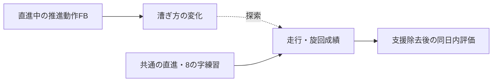

# 中間発表資料

実施時はPCブラウザーへ設定・進行を分け、被験者にアプリ操作を求めない。[操作と確認状況](development/experiment-console.md)

12枚相当の発表本文と、説明・質疑用のメモ。研究の目的から実施準備までを順に説明する。結果はまだ取得していない。詳細は[研究計画](study-plan.md)と[実験手順](experiment-protocol.md)を参照する。以下では追加フィードバックを「FB」と略す。

---

## 01｜研究題目と問い

**走行中の推進動作フィードバックが車いす初心者の平地操作技能の獲得と同日内保持に及ぼす影響**

聴覚・視覚・追加FBなしの小規模3群比較

- 音で漕ぎ方を伝えることは、支援を外した走行・旋回成績にどう関係するか。
- 漕ぎ方の変化と、操作の速さ・正確さを合わせて評価する。

発表者：上山颯太／指導教員：塗木淳夫（原資料の表記）

<details><summary>発表メモ</summary>

車いすの操作には、直進だけでなく旋回や加減速も必要です。この研究では、会場と1回来訪の時間内で測れる平地の操作に範囲を絞ります。現在は実施準備の段階で、研究計画を説明します。

</details>

---

## 02｜背景：漕ぎ方と操作技能

- 車いすの移動には、推進動作に加えて旋回・加減速が必要。
- 接触角・頻度は推進動作の指標になるが、単純な最大化・最小化は避ける。
- 今回は力・代謝・傷害を測らず、操作成績と運動学の変化を扱う。

出典：[Richter 2011](../research/papers/L15-richter-2011.md)、[Symonds 2016](../research/papers/L17-symonds-sensewheel-2016.md)、[亀ヶ谷ら2021](../research/papers/L53-kamegaya-2021.md)。

<details><summary>発表メモ</summary>

接触角が大きくなっても、速度や力が同時に増える場合があります。位置の計測で分かるのは運動学的な変化で、推進力や傷害予防への効果までは判断できません。旋回には左右差も必要です。操作時間と漕ぎ方を、それぞれの指標として読みます。

</details>

---

## 03｜先行研究と今回の位置づけ

| 研究 | 参考になる点 | 今回との違い |
|---|---|---|
| Gref 2016 | 車いす動作の音への変換 | 質的評価が中心 |
| Symonds 2016 | 走行中、直前のプッシュへ修正方向を教示 | 人による言語FB、保持未評価 |
| Yan 2021 | 視覚FBでも保持・転移が生じる | 区間終了後の要約FB |
| 亀ヶ谷ら2021 | 5 m・1周8の字の計時 | 検者間信頼性。学習への反応性は未検証 |

出典：[Gref](../research/papers/L13-gref-2016.md)、[Symonds](../research/papers/L17-symonds-sensewheel-2016.md)、[Yan](../research/papers/L14-yan-2021.md)、[亀ヶ谷ら](../research/papers/L53-kamegaya-2021.md)。

<details><summary>発表メモ</summary>

先行研究には車いすの音化、言語による動作支援、視覚FBでの保持があります。本研究はそれらを踏まえ、同じ推進情報を伝える音と表示を、無FBでの平地操作成績で比較します。Fujiiらの研究は聴覚FBの頻度比較で、視覚との直接比較ではありません。[Fujii 2016](../research/papers/L05-fujii-2016.md)

</details>

---

## 04｜研究目的・仮説

- 主要な問い：休憩後の無FBでの8の字時間に、群による違いがあるか。
- 副次の問い：接触角が目標へ近づき、時間・正確さの変化と関連するか。
- 聴覚の有用性を期待するが、視覚より優れると決めつけず両側で比較する。



<details><summary>発表メモ</summary>

研究の中心は、支援を外した後の操作成績です。角度だけが変わる結果や、時間だけが変わる結果も含めて報告します。漕ぎ方と操作成績に関連があっても、それだけで効果の仕組みを証明したとは解釈しません。[研究の問い](study-plan.md#研究の問い)

</details>

---

## 05｜実験デザイン

- 車いす未経験の成人学生等15名：聴覚5／視覚5／追加FBなし5。
- 並行3群へ無作為割付。共通の教示・目標・機器・練習量。
- 1回来訪90分以内。48時間後の再来訪なし。
- 脳波計は未到着のため、今回の測定・分析へ組み込まない。

<details><summary>発表メモ</summary>

割付は事前評価と理解確認の後に開示します。目標算定に必要な事前データが足りない場合は、追加走行をせず割付前の理由として記録します。N群にも同じ教示と個人目標を伝えます。15名は実施可能性から設定した人数で、推定には不確実性が残ります。[対象と割付](operations/study-operations.md#対象と割付)

</details>

---

## 06｜課題：直進と8の字

| 課題 | 構成 | 役割 |
|---|---|---|
| 8の字 | コーン間5 m、1周、2反復 | 主要な走行・旋回成績 |
| 直進 | 10 m、2反復、角度は中央2–8 m | 漕ぎ方・頻度・速度の副次評価 |

- 両方を訓練。全評価は無FB、8の字→直進の順。
- ボール課題と独立した転移テストは設けない。

出典：[8の字原著](../research/papers/L53-kamegaya-2021.md)、[WPT原著](../research/papers/L54-askari-2013.md)。

<details><summary>発表メモ</summary>

8の字は、左右のコーンを両方回ってから計時を終えます。原著を参考にしていますが、動画計時、反復、訓練への使用は本研究で加えた条件です。両課題を練習するため、再評価は独立した転移テストにはなりません。[実施方法](experiment-protocol.md)・[原著から加えた条件](decisions.md#先行課題から取り入れる部分)

</details>

---

## 07｜走行中に何を返すか

- 主要側の直前プッシュの推定接触角を、個人目標との関係で3状態にする。
- 直進の中央区間のみ、プッシュ終了後の回復期に提示を開始する。
- 8の字・旋回・停止・無効計測では提示しない。

```text
プッシュ → 離手 → 次接触前に提示を開始 → 原則300 ms
                                        次プッシュへの継続は許容
```

<details><summary>発表メモ</summary>

接触角は離手まで確定しないので、直前の動作への情報を回復期に返します。次の接触後には古い情報の提示を新しく始めません。既に始めた提示が次のプッシュへ続くことは認め、記録します。高い基準角の人には維持を求める個人目標を使います。[目標と提示規則](specifications/feedback.md)

</details>

---

## 08｜見せる画面・聞かせる音

```text
実空間の視界を保つ
           ┌───────┬────────┬───────┐
視覚       │ 短い ●│ 目標範囲 │ 長い  │  ← マーカー位置のみ変化
           └───────┴────────┴───────┘
聴覚         440 Hz    660 Hz    880 Hz
```

- 両条件とも300 ms。音量一定の純音、視覚に数値・履歴を追加しない。
- 全員に両方の意味を説明し、非運動の模擬提示で理解確認する。
- 走行中の知覚と、実空間の安全な視認を予備実験で確認する。

<details><summary>発表メモ</summary>

マーカーの左右は角度の大小を表し、曲がる方向ではありません。高い音は「よい」という意味ではなく、次を短くする目安です。視野下部の表示を想定していますが、実機で読みやすさと走行路の視認を確かめてから位置や大きさを固定します。[画面・音](specifications/feedback.md)・[説明と理解確認](operations/participant-materials.md#説明と理解確認)

</details>

---

## 09｜1回来訪90分の流れ

| 経過 | 内容 |
|---|---|
| 0–33分 | 説明・装着・習熟・事前・目標と理解確認 |
| 33–52分 | 直進と8の字の訓練：実動12分、切替・休憩込み19分 |
| 52–57分 | 無FB直後評価・短い質問紙 |
| 57–77分 | 座位休憩20分 |
| 77–82分 | 無FB短時間保持評価 |
| 82–90分 | 取り外し・体調確認・説明 |

**訓練終了→保持開始は約25分。20分は休憩の長さ。**

<details><summary>発表メモ</summary>

訓練は直進2分と8の字2分を3セット行い、切替とセット間休憩を合わせて19分です。休憩後の成績には、訓練に加え、直後評価の課題経験も含まれます。翌日以降の定着を示す評価ではないため、同日内の成績として報告します。技術的な再試行と実際の時刻も残します。[進行表](experiment-protocol.md#90分の進行)

</details>

---

## 10｜評価と分析

- 主評価：休憩後8の字の2反復平均時間。事前時間で調整して群を比較。
- 必須併記：接触・経路誤り・未完了、直進の角度・頻度・速度。
- 分析単位は参加者。群差と95%区間、個人の変化を示す。
- 未完了を60秒の完了値にせず、欠測理由と完了率を報告する。
- 正常計測でプッシュが少ないだけでは再試行せず、副次評価は記述に絞る。

<details><summary>発表メモ</summary>

主要比較は、聴覚と追加FBなし、聴覚と視覚の2つです。p値を示す場合はHolm補正し、区間は個別のモデル区間として示します。副次・補助評価は個人の3時点の推移と群別の記述を中心にします。プッシュが多くても人数は増えません。欠測理由と完了率も示します。[集約式と比較方法](analysis-plan.md)

</details>

---

## 11｜結論の範囲と実施前の確認

- 扱えるのは、本装置・平地課題・初心者の小標本での同日内の変化。
- 長期定着、日常生活全般、傷害予防、聴覚一般の優位性は直接結論できない。
- 機器・追跡範囲・接触角推定・提示・動画を実機で確認する。
- 教員・倫理手続き、安全補助者、同意・保管規則を確定する。

<details><summary>発表メモ</summary>

装置は推定角だけでなく、3状態のそれぞれの精度、境界付近の誤分類、追跡欠損、回復期の実提示開始を確認します。会場の床材・実寸・追跡範囲も実測が必要です。通し予備実験で、課題理解、負担、90分の進行を確かめます。[検証計画](specifications/validation.md)・[開始条件](operations/study-operations.md#本計測開始条件)

</details>

---

## 12｜今後の工程

| 2026年 | 成果 |
|---|---|
| 10/14–10/25 | 教員・倫理手続き・会場・機器・補助者の確認 |
| 10/26–11/08 | 装置実装と計測・提示・動画の検証 |
| 11/09–11/15 | 2–3名の通し予備実験、条件の確定 |
| 11/16–12/13 | 15名の本計測 |
| 12/14–12/20 | 予備日・データ点検、収集終了 |

次の判断は、[G1–G6の開始条件](operations/study-operations.md#本計測開始条件)が揃ったかどうか。

<details><summary>発表メモ</summary>

本計測は、必要な倫理手続き、安全確認、機器検証、通し予備実験、条件確定、運営の準備を終えてから始めます。予定に間に合わない場合は、担当教員と範囲や日程を再検討します。[実施運営](operations/study-operations.md)・[文献一覧](../research/catalog.md)

</details>

ソフト実装・画像・合成入力試験と、実機・予備実験・責任者確認の状況は[残作業表](development/remaining-work.md)で区別する。APKの配布は本計測開始の判断を代替しない。
