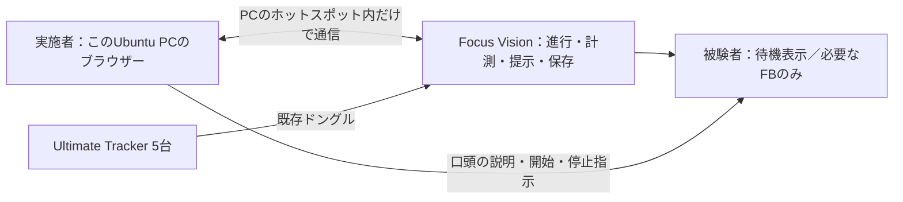

# 被験者と実施者の操作設計

**被験者はアプリを操作しない。実施者がノートPCのブラウザーから進行し、ゴーグル内のプログラムが計測・提示・記録を行う。** 被験者に設定画面や数値入力を見せず、コントローラーを渡さない。

この分担に沿ってPC操作・全体進行・被験者用表示を実装する。[起動・操作](../development/experiment-console.md)と[確認証拠・残作業](../development/remaining-work.md)を参照する。ソフトウェアの動作確認と、実機・現地での本計測受入れは区別する。

## 誰が何をするか

| 内容 | 被験者 | 実施者 | プログラム |
|---|---|---|---|
| 同意・利き手・体調 | 説明を受け、回答する | 確認・記入する | 実名・同意書を扱わない |
| 研究用ID・機器・コース | 入力しない | 初期設定と安全点検 | 重複・未接続・設定不足を検査 |
| 装着・校正 | 楽に座り、指示された位置へ手を添える | 取り付け、姿勢合わせ、収録操作 | 左右の軸・接触基準を計算し品質を確認 |
| 課題・時点・反復 | メニューで選ばない | 次の課題を口頭で説明し、開始を指示 | 順番と反復番号を管理 |
| 個人目標・群 | 数値を入力・選択しない | 基準成立を確認し、割付表の群を登録 | 事前2反復から目標算定、登録後固定 |
| 模擬提示の理解確認 | 声で答える | 回答を記録 | 提示順・300 ms・待ち時間を管理 |
| 走行 | 説明された課題を行う | 周囲を見て安全を確保 | 位置姿勢・推進候補・FB・異常を処理 |
| 試行の終了 | 終点を通過し、安全に停止 | 終了・中止の区別を確認 | 保存、次の予定、休憩を準備 |
| 質問紙 | 規定の用紙または口頭で回答 | 同じ方法で回収・記入 | HMDでの文字入力を求めない |
| 保存・取り出し | 操作しない | 件数とコピーを確認 | 自動書出し、未完了表示、ZIP・チェックサム作成 |

校正に必要な手の位置合わせ、提示の理解確認、質問紙は研究手続きであり、設定操作の省略と一緒に取り除かない。確認方法を変える場合は全群で揃え、研究手順との整合を確認する。

## 現地の構成



会場のWi-Fi・インターネット回線を前提にしない。このPCが一時的なアクセスポイントを作り、Focus Visionを接続する。PCのAP対応は確認済み。ゴーグルとの実接続と現地範囲での安定性は未確認。[会場ネットワーク](../development/field-network.md)

Unityのセンサー取得・判定・300 ms提示をブラウザーとの往復通信で行わない。PCは操作と状態確認、ゴーグルは時間に敏感な処理と元データの保存を担当する。PCにUnity・VIVE Hubの常時実行を求めない。操作ページはローカルで配信し、外部サイト・クラウド・Webフォントへ依存させない。

## 被験者の画面

| 場面 | 見せるもの | 操作 |
|---|---|---|
| 装着・準備・停止後の待機 | 必要な場合だけ、大きな短文「準備中」「そのままお待ちください」 | なし |
| 説明・理解確認 | 実施者が送った音またはマーカー。正答・設定値は見せない | 口頭回答のみ |
| 訓練直進・V群 | [FB仕様](feedback.md)の3領域ゲージ | なし |
| 訓練直進・A群 | 音のみ。操作パネル・ゲージなし | なし |
| 訓練直進・N群 | 追加FBなし | なし |
| 8の字・全評価 | 操作パネル・ゲージ・成績表示なし | なし |
| 異常 | FBを止める。走行中に大きな設定・エラー画面を突然出さない | 実施者の声で停止。不快・異常は声で知らせる |

群名、ID、電池・接続の詳細、経過時間、次へボタン、校正ボタン、保存先、数値パッドは被験者画面に出さない。不要な待機表示も走行前に消す。視界の確保と提示の読み取りは実機で確認する。

## 実施者の画面

普段使うのは**実験進行の1画面**とする。機器設定を毎試行開かず、現在の状態と次の1操作を大きく表示する。

```text
P001   事前評価：8の字 1/2                 [中止]
---------------------------------------------------
追跡 5/5   校正 有効   保存 正常   通信 接続

次：経路を説明し、開始位置で静止を確認

                 [ この試行を開始 ]

予定：8の字2回 → 直進2回 → 目標・理解確認
---------------------------------------------------
[実施前設定] [記録・例外対応]
```

走行中は主ボタンを「終了・安全停止の確認」に切り替える。経過時間は実施者だけに表示し、動画の正式な完了時間とは呼ばない。群の開示前は割付を表示しない。

設定・校正は実施前用の別ページへ分離する。走行中はID、群、主要側、校正、閾値、順序を変更できない。生の座標や詳細診断は通常画面に常時並べず、異常の調査時だけ開く。

## 手順をプログラムで進める

順番・練習量は[90分の手順](../experiment-protocol.md#90分の進行)を唯一の定義とする。アプリはその手順に沿った来訪全体の予定を持ち、実施者が時点・課題・反復を毎回指定する方式をやめる。

| 区間 | 自動化 | 実施者の判断 |
|---|---|---|
| 準備 | 前回設定の読込み、不足項目の一覧 | 本日の会場・椅子・装着・安全確認 |
| 事前評価 | 8の字2回→直進2回、試行IDと反復の採番 | 各開始、安全停止、動画が撮れていること |
| 基準確認 | 有効角数と個人目標の算定 | 不足・技術的不成立の処理、割付表の登録 |
| 理解確認 | 規定の模擬提示と正答数・時間の集計 | 説明と口頭回答の入力 |
| 訓練 | 直進2分・切替・8の字2分を3セット、セット間休憩の計時 | 開始の安全確認、2分後は新しい周回を始めない指示 |
| 直後評価 | 規定順の2課題・各2反復 | 各開始・終了・質問紙の回収 |
| 保持前休憩 | 実施者が休憩開始を確定して20分計時、早い開始を防ぐ | 静かな座位・中断・眠気等の記録 |
| 保持評価 | 同じ順序・反復数、無FBの固定 | 各開始、安全、動画の確認 |
| 終了 | 全試行の完了／未完了とファイルを一覧、自動保存 | 体調確認、取り外し、回収・照合 |

「次の予定を自動で選ぶ」と「人が準備していなくても走行を自動で始める」を区別する。移動・整列・口頭教示・休憩後の開始は実施者の確認を必要とする。10秒の準備時間は実施者側に表示し、被験者にボタン操作やコントローラーを置く作業を求めない。

8の字は単に静止しただけで「1周を正しく完了」と判定しない。経路誤り・接触・正式な完了時間は動画を基準にし、ソフトの自動終了で置き換えない。技術的な再試行の上限、正常な少数プッシュを追加走行させない規則、90分上限は維持する。

## 校正の負担を実施前へ移す

会場・コース・車輪・車体の校正は、可能な範囲で最初の被験者の前に実施者が済ませる。左右のキャンバーを含む幾何校正は保持し、次の人でも有効性を確認できた部分だけを再利用する。装着変更、再接続、座標変更、固定具の緩みがあれば関連する校正を無効にする。

手首は人・装着位置で変わるため、前の人の校正を無条件に使わない。被験者は座位で手をリムの3位置へ添え、実施者がブラウザーから収録する。役割照合、収録開始、確定、品質判断を被験者へ任せない。習熟動作だけから完全自動で校正できるという保証は置かない。

## 例外と記録

- HMD・トラッカーの不成立、保存失敗、安全停止では提示を止める。元データと理由を残し、被験者へ診断画面の操作を求めない。
- 実施者との通信が途切れたら、追加FBを停止し、実施者に切断を通知する。その試行は未完了として保存し、自動再開しない。実施者は口頭で安全停止させる。初期の有効期限は3秒、確認周期は500 msとする。ブラウザーの残り有効時間をゴーグルへ伝え、通信の往復時間も保守的に差し引く。予備確認後に固定する。
- PCの画面が止まっただけで、最後の「接続正常」「保存成功」を正常な最新状態として表示し続けない。状態の鮮度を示し、開始を拒否する。
- 再接続後は保存済みの予定と実施済み試行を復元し、終了確認・再試行・中止を実施者が選ぶ。同じ開始要求の再送で試行を二重作成しない。
- 再試行には元試行との対応・理由・回数を残す。成績を見てやり直す操作は設けない。
- 終了ごとにゴーグルへ保存し、PC切断だけで元データを失わない。取り出しは実施者が行う。[保存形式](../development/research-records.md)

## 実装・本計測へ進む確認

ブラウザーと共通処理を接続した単体・結合・合成入力試験を行い、実機・現地では次を確認する。PCでの成功を実機の測定性能とみなさない。

1. 被験者役がコントローラー・キーボード・数値入力なしで準備から終了まで進める。
2. 実施者役が同じHMDを交互にかぶらず、PCで次の試行・不足・異常を把握できる。
3. 課題順・反復・休憩20分・無FB時点が[実験手順](../experiment-protocol.md)と一致する。
4. PCまたはブラウザーの切断・再起動・二重クリックで、二重開始・誤った継続・データ消失を起こさない。
5. 現地全範囲の通信・追跡・視認性・実出力と90分の通し確認を行う。PCの継続試験と、これらの未完了の実機受入れを分けて記録する。

15名・並行3群・1回来訪90分・20分休憩・動画による8の字主要評価・音と提示時間は変更しない。脳波も追加しない。
