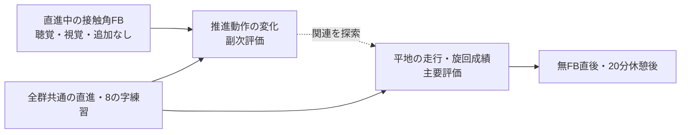

# 研究計画：走行中の推進動作FBと平地操作技能

研究仕様 v1.1／2026-10-15。[資料入口](README.md)・[決定台帳](decisions.md)。以下は実施予定であり、結果の報告ではない。

## 題目・目的

**走行中の推進動作フィードバックが車いす初心者の平地操作技能の獲得と同日内保持に及ぼす影響：聴覚・視覚・追加FBなしの小規模3群比較**。

推進動作について同じ情報を、聴覚または視覚で走行中に返すことが、平地での直進・左右旋回・加減速を組み合わせた操作成績にどのような違いをもたらすかを調べる。研究の中心は漕ぎ方だけの再現精度ではなく、**無FBでの走行・旋回成績**。漕ぎ方の変化を副次評価し、操作成績と合わせて解釈する。

「車いす技能全体」への関心を、今回測定可能な平地操作へ具体化した。坂・段差・移乗・後輪バランス・スポーツ技能を含む総合的な車いす能力、実生活での自立度を評価する研究ではない。

## 背景と研究上の空白

手動車いすでは推進動作の特徴が重要だが、接触角の増大や頻度の低下を、そのまま上肢負担の低減と同一視できない。単一変数の変更が力や速度の増加を伴う報告がある。本研究では力・トルク・代謝・傷害を測定せず、これらへの効果を結論にしない。[L15](../research/papers/L15-richter-2011.md) [L17](../research/papers/L17-symonds-sensewheel-2016.md)

追加FBは動作の変化を支えうる。一方、練習中の成績は支援の即時効果も含むため、支援を外した評価が必要である。20分の休憩は今回の負担と時間から選んだ条件であり、翌日以降の定着を保証しない。[L03](../research/papers/L03-kantak-2012.md) [L05](../research/papers/L05-fujii-2016.md)

| 近縁研究 | 確認できたこと | 今回との違い |
|---|---|---|
| [Gref 2016](../research/papers/L13-gref-2016.md) | 車いすの速度・旋回・傾きを音へ変換した質的評価 | 推進角の3状態、3群の学習比較、無FB保持を検証していない |
| [Symonds 2016](../research/papers/L17-symonds-sensewheel-2016.md) | 走行中、回復期に直前のプッシュへ言語FBを提供 | 人による教示。無作為対照・無FB保持の評価なし |
| [Yan 2021](../research/papers/L14-yan-2021.md) | 区間終了後の視覚要約FBで保持・実走行への転移を報告 | 走行中の純音と視覚を比較していない。48時間後の評価あり |
| [亀ヶ谷ら 2021](../research/papers/L53-kamegaya-2021.md) | 健常成人の5 m・1周8の字で検者間の計時一致を検証 | 訓練介入ではなく、反応性・再テスト信頼性は未検証 |

今回の貢献は、既存機器を使う検証可能な推進動作FB、情報を揃えた感覚条件の比較、走行旋回成績と推進指標の併記、無FBの同日内評価を組み合わせることに置く。世界初、聴覚全般の優位性、視覚FBの一般的な欠点を前提にしない。

## 研究の問いと仮説

| ID | 問い・予測 | 評価 |
|---|---|---|
| Q1／主要 | 聴覚FBで訓練した群の休憩後の8の字所要時間は、追加FBなし群・視覚FB群と異なるか | 事前値で調整した2つの群差。両側で評価 |
| Q2／副次 | 直進中の接触角が目標へ近づき、FB除去後にも変化が残るか | 接触角・プッシュごとの目標絶対誤差・頻度・速度を事前／直後／休憩後で記述 |
| Q3／副次 | 時間の短縮に接触・経路誤り・未完了の増加が伴うか | 各試行のエラー、完了率、中止理由 |
| Q4／補助 | 提示の理解、主観的負荷、快適性、データ有効率はどうか | 理解確認、質問紙、運用ログ |

聴覚の有用性は期待するが、現時点の先行研究は今回の課題・マッピングでの優位性を確定しない。主要な検定は方向を限定しない。「時間短縮＝効率改善」「角度増大＝傷害予防」と読み替えない。認知負荷は補助的な主観評価とし、神経機序の検証は目的に含めない。

接触角の変化と所要時間の変化が関連しても、それだけで媒介・因果機序を証明したとはしない。

## 研究デザイン

- 車いす未経験の成人学生等15名を、A：聴覚、V：視覚、N：追加FBなしへ各5名。並行群の無作為割付とする。
- 予備実験2–3名は本標本に含めない。15名は実施可能人数から設定した探索的な規模で、検出力を保証する人数ではない。[L48](../research/papers/L48-lakens-2022.md)
- 全群に同じ基本教示・個人目標・課題・練習時間・休憩・機器装着を与える。N群にも自己感覚と通常の環境情報、共通教示はある。
- 同じ人を全条件で順に学習させる方式は採用しない。先の学習を元へ戻せず、持越しを感覚の効果と区別しにくいため。
- 割付は事前評価後に開示する。参加者と実施者の感覚条件の盲検化は困難。動画の計時・エラー採点では可能な範囲で群を隠す。

## 課題・介入・時点

主要課題は、5 m離したコーン2本を回る8の字1周。別に10 m直進を行い、推進動作を評価する。両課題を訓練し、事前・直後・休憩後に、同じ教示・順序・2反復で無FB評価する。[課題と採点](experiment-protocol.md)

直進中は直前の主要側プッシュの推定接触角を3状態に変換し、回復期に開始する原則300 msの音またはゲージで返す。次の接触開始後に前プッシュの提示を新規開始せず、開始済みの提示が次プッシュへまたがることは許容・記録する。個人目標は最大＋10°とし、95°へ近づくほど増分を減らし、基準95°以上では維持する。8の字中は全群とも追加FBなし。漕ぎ方の支援を旋回へそのまま当てはめず、旋回に必要な左右差をエラーとして罰しない。[FB仕様](feedback-specification.md) [L31](../research/papers/L31-soltau-2015.md)

訓練は実動12分（直進6分、8の字6分）、切替・休憩込み19分。独立した転移課題は設けない。練習した8の字の再測定を「転移」と呼ばない。

90分の予定では訓練終了52分、直後評価終了57分、休憩57–77分、保持評価開始77分。したがって**休憩は20分、訓練終了から保持評価開始までは約25分**。各人の実時間を記録する。

休憩後の評価は、訓練に加えて直後の無FB評価（8の字2回・直進2回）も経験した後の同日内成績を測る。訓練のみの保持や記憶固定化を分離する設計ではない。全群の予定評価量を揃え、技術的再試行は理由と実施量を記録する。正常計測でプッシュが少ないことだけを理由に追加走行を行わない。

## 分析・結論の範囲

主アウトカムは参加者ごとの休憩後8の字2反復の平均時間[s]。事前平均時間で調整したANCOVAを使い、聴覚−追加FBなし、聴覚−視覚の群差と95%区間を示す。多数のプッシュ・反復を独立した人数にしない。[分析計画](analysis-plan.md)

副次・補助評価は事前・直後・休憩後の個人推移、群別の記述値、訓練セット別の推移を示し、新たな有意差検定を追加しない。事前角度から個人目標を作るため、群内の目標誤差減少だけをFB効果とせず、N群の変化も合わせて解釈する。

5名ずつでは大きな不確実性が残る。非有意は無効果・同等の証明ではない。群平均だけでなく個人の変化、欠測・未完了、速度と正確さの交換関係を示す。測定精度や実施可能性、差の幅が明らかになることも卒業研究の成果になる。

本研究から言えるのは、本装置・本課題・初心者の小標本での推進動作FBと平地操作成績の関係、同日内の変化である。長期保持、他の生活技能、日常利用者、肩の負担・傷害、感覚一般への外挿は限界として残す。力計測を伴わない接触角推定の制約も明示する。

## 実施前の判断

[開始条件G1–G6](study-operations.md#本計測開始条件)を満たしてから本計測を始める。教員・倫理手続き、現地、実機の確認が必要。数値を変える場合は本計測前に理由と版を記録し、群ごとに異なる仕様を混ぜない。
