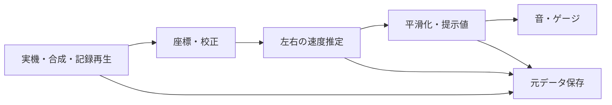

# Unity・計測機器の開発とテスト

初心者向けの読み物。Unity 6000.6.4f1、Input System 1.19.0、Test Framework 1.8.0、XRI 3.4.1を対象とする。確認日：2026-10-21。公式仕様と、以下の本研究への推奨を分けて読む。現行設定の正本は[FB仕様](../../docs/specifications/feedback.md)。

## 模擬入力と実機

模擬入力で早く開発し、早期に実機の接続・追跡範囲も確認する。「仕様どおりのプログラム」と「研究に必要な精度」は別。

| 手段 | 確認すること | 分からないこと |
|---|---|---|
| 画面モック | 配置・操作の理解 | 実際のUnity描画 |
| 固定値を返すスタブ | 既知速度から音・表示を作る | 追跡誤差 |
| 呼出しを記録するモック | 保存・提示を何回呼んだか | 実出力 |
| 合成した位置姿勢 | 回転・欠測等の計算 | 現実の誤差分布 |
| 実測記録の再生 | 再現・改修前後の比較 | 新しい現場条件 |
| 実機を接続 | 接続・固定・処理速度 | 学習効果の一般性 |

UnityのDevice Simulatorは主にモバイルの画面、XR Interaction SimulatorはHMD・コントローラー入力の模擬。車輪の接触や現実の追跡誤差の再現ではない。[Device Simulator](https://docs.unity3d.com/6000.6/Documentation/Manual/device-simulator.html)・[XR Simulator 3.4](https://docs.unity3d.com/Packages/com.unity.xr.interaction.toolkit@3.4/manual/xr-interaction-simulator-overview.html)

## 分けて作る

Unity固有の表示と、計算・判定を分ける。入力だけ差し替えて同じ処理を使うと、記録を再生して不具合を直せる。接触区間を仮定して角度を作る方式は現在採用しない。

| 試験 | 本研究での例 |
|---|---|
| 単体 | 359°→1°、既知速度、符号・上限、50 ms平滑化 |
| 結合 | 位置姿勢→左右速度→音・棒→ファイル |
| 回帰 | 同じ記録で改修前後の結果を比較 |
| 異常系 | 欠測、再接続、保存・転送失敗、古い操作 |
| 実機 | 5台、キャンバー、左右音、再装着 |
| 継続・現地 | 電池・容量・全走路・単独見守り・予備実験 |

Edit Modeは計算、Play Modeは実際のコンポーネント・画面・状態を確認する。ビルド済みアプリも対象環境で試す。[Test Framework / Unity 6000.6](https://docs.unity3d.com/6000.6/Documentation/Manual/test-framework/edit-mode-vs-play-mode-tests.html)

## 小さく進める

手動で左右速度を渡して提示 → 既知速度の自動確認 → 合成姿勢 → 実機取得・保存 → 記録再生で改善 → 既知回転の独立参照 → 通し予備実験。各段階で入力、結果、失敗と次へ進める根拠を残す。プレビュー生成成功だけで画像を合格にしない。2分・20分の処理は固定時計で確認し、通常の自動試験に実時間の待機を入れない。

小さく変更してGitへ記録し、設定を一元化する。デバッガーで実行途中の値、Profilerで時間・メモリー、ログで不具合の再現条件を調べる。固定データと仕様・試験の対応を残し、予備実験後に設定を固定する。カバレッジ（実行したコードの割合）だけで品質を判断しない。CI（自動で継続実行する仕組み）は必要になってから追加できる。[Microsoftのテスト指針](https://learn.microsoft.com/en-us/dotnet/core/testing/unit-testing-best-practices)

既存機器では公式サンプルから位置姿勢、単位・軸・ID・追跡状態を確かめ、固定・遮蔽・再接続・電池を確認する。マイコン自作を選ぶ場合だけWokwi等の回路模擬が役立つが、無線・固定・センサー実誤差は実機検証が要る。[Wokwi](https://docs.wokwi.com/)

具体的なチェックは[検証計画](../../docs/specifications/validation.md)、実行コマンドは[開発ガイド](../../docs/development/guide.md)。API呼出し時刻は実音・実表示の時刻ではない。PNGとWAVは配置・波形の事前確認を増やす手段で、実機の精度や快適性を保証しない。
