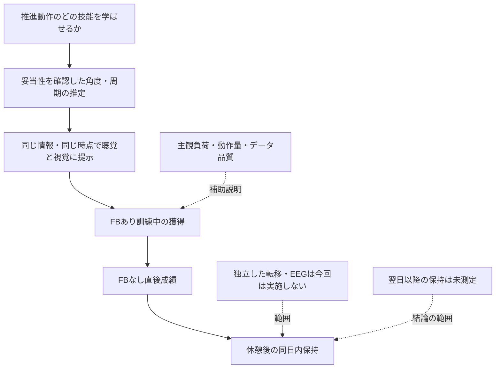

# 全体のまとめと研究の位置づけ

## 今回の研究で狙える貢献

手元の位置トラッカーを用いて推進動作の情報を推定し、**同じ情報を聴覚・視覚・無FBの3条件で比較して、FBを外した同日内の成績を調べる小規模研究**が現実的である。長期定着・肩の傷害予防は今回の測定から直接結論できない。EEGは機器未到着のため今回の計画から外し、文献を保存した。現行の方法は[docs](../docs/README.md)に置く。

車いすソニフィケーションはすでに存在する。[L13](papers/L13-gref-2016.md)は速度・旋回・傾きを音にする質的研究、[L17](papers/L17-symonds-sensewheel-2016.md)は実走行で前ストロークの角度を見て声をかける研究、[L16](papers/L16-guo-optipush-2011.md)の計測輪にも頻度用ビープがある。新規性の候補は「初めて音を使うこと」ではなく、推進指標に結びつく簡素な設計、計測の検証、条件を揃えた比較、無FB短時間保持である。最終的な先取性の断定には追加の網羅検索が必要。

## 文献から比較的言えること

| 知見 | 根拠の性質 | 本研究への意味 |
|---|---|---|
| 追加FBで推進角・頻度は変わりうる | 車いすで直接の研究・レビュー [L14](papers/L14-yan-2021.md) [L15](papers/L15-richter-2011.md) [L17](papers/L17-symonds-sensewheel-2016.md) [L18](papers/L18-symonds-review-2018.md) | 訓練対象の候補。ただし計測できることが先 |
| 1変数の改善は他変数の悪化を伴うことがある | 直接実験 [L15](papers/L15-richter-2011.md) [L17](papers/L17-symonds-sensewheel-2016.md) | 最大化・最小化を目標にしない。力を測らない場合は負担軽減を主張しない |
| 視覚FBでも保持・転移は生じる | 直接RCT [L14](papers/L14-yan-2021.md)、長期訓練 [L19](papers/L19-rice-2013.md) | 視覚を不利と決めた背景説明を修正する |
| 聴覚の効果は課題・マッピング・頻度に依存 | 上肢・ボート・車いす [L05](papers/L05-fujii-2016.md) [L06](papers/L06-sigrist-terminal-2013.md) [L10](papers/L10-effenberg-2016.md) [L13](papers/L13-gref-2016.md) | 聴覚全般の優位性より、今回の設計を検証する |
| 位置や加速度から得る指標は検証を要する | 計測研究 [L25](papers/L25-ojeda-2014.md) [L27](papers/L27-fathian-timing-2024.md) [L28](papers/L28-fathian-pattern-2025.md) [L50](papers/L50-niehorster-2017.md) | 相関だけでなくイベント誤り、角度誤差、追跡欠損を測る |
| 簡易EEGは一部条件で使える | 機器別検証 [L34](papers/L34-krigolson-2017.md) [L35](papers/L35-badcock-2013.md) [L41](papers/L41-ratti-2017.md) [L42](papers/L42-kam-2019.md) [L46](papers/L46-lee-2026.md) | 今回は保留。将来追加時には生データ・電極・品質を先に確認 |

## 意見が割れる点をそのまま残す

[L05](papers/L05-fujii-2016.md)では高頻度の並行聴覚KPが有利だったが、[L06](papers/L06-sigrist-terminal-2013.md)では終了後視覚FBが有利だった。[L07](papers/L07-sigrist-multimodal-2015.md) [L10](papers/L10-effenberg-2016.md)の肯定的結果は視聴覚の組合せで、聴覚のみの優位性ではない。[L11](papers/L11-scholz-2016.md)の初期の臨床的期待に対し、[L49](papers/L49-nikmaram-2019.md)の追試では臨床検査への追加効果を支持する証拠が乏しい。対象・課題・情報量・提示時点が異なるため、これらを同じ効果量としてまとめない。

「視覚チャネルを空けられる」は設計上の利点になりうるが、「総認知負荷が必ず下がる」とは別である。[L13](papers/L13-gref-2016.md)では難しい操作中に音を追うことが負担となり、[L39](papers/L39-bilalpur-2018.md)では音パラメータによって認知負荷が変わる。質問紙と行動指標を合わせて検討する。

## 概念と評価のつながり

## 原案から変える優先順位

1. 主要評価を休憩後の8の字時間に置き、正確さと直進の推進指標を副次として揃える。位置だけで推進力を出す計画を修正する。
2. 接触・離手と角度を、動画等の参照に対して検証する。検証前の音の作り込みを抑える。
3. ゴーグルの型番・視界・追跡範囲を確認する。20 mコースを計測できると仮定しない。
4. 3条件の情報と練習量を揃え、全評価から追加FBを外す。
5. 1回来訪、休憩後の短時間保持までを評価し、長期定着の限界を明示する。
6. EEGは今回の実施予定から外す。直進・8の字を両方訓練するので、再評価を転移とは呼ばない。

実装に借りやすいのは、[L33](papers/L33-kimura-2016.md)のイベントから数状態の音へ変換する構成、[L16](papers/L16-guo-optipush-2011.md)の数ストローク平均と目標表示、[L17](papers/L17-symonds-sensewheel-2016.md)の回復期の方向性FB、[L25](papers/L25-ojeda-2014.md)の参照データに対する検証である。[装置比較](implementation/device-comparison.md)で必要機材と導入難度を整理した。

## 課題とFBを具体化した際の追加知見

[L53](papers/L53-kamegaya-2021.md)の5 m・1周8の字は健常成人での計時一致の先例であり、反応性・再テスト信頼性は未検証。[L54](papers/L54-askari-2013.md)のWPTは普段の速度の10 m直進。[L58](papers/L58-salm-2025.md)は初心者の多くの推進指標で二重課題差が明瞭でなかった。課題を難しくする前に測定の目的・ばらつき・成立性を確認する。

採否と文献の測定特性は[課題レビュー](topics/wheelchair-skill-assessment.md)、具体的な画面・音への変換は[FB案比較](topics/feedback-design-alternatives.md)を参照。
